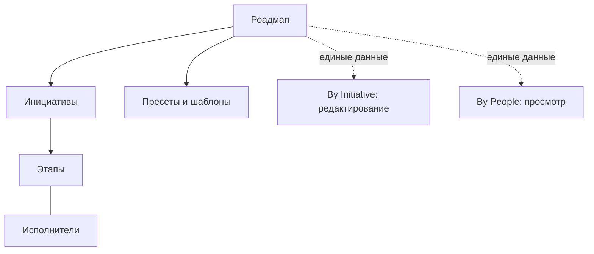
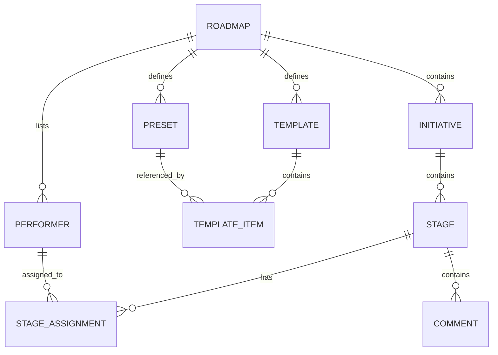

# OnlyPlans — Business Analysis v3.0

**Дата:** 19 ноября 2026 г.  
**Статус:** согласованные в рабочем обсуждении продуктовые решения; консолидированная редакция для командного ревью. Не является утверждённой технической спецификацией или подтверждением готовности функций.  
**Объём:** первый прототип, последующие итерации MVP и направления развития.

## 0. Как читать документ

Документ объединяет БА Даши и Арины, заменяя противоречащие друг другу требования решениями, принятыми в совместном обсуждении. Последнее явное решение имеет приоритет над более ранним. Отдельно отмечены вопросы, которые требуют уточнения; предложенные критерии приёмки и логическая модель не являются утверждённым дизайном или физической схемой БД.

- **P (Prototype)** — входит в первую итерацию.
- **M (MVP next)** — согласовано для MVP, но не для первого прототипа.
- **L (Later)** — за пределами MVP либо не требуется сейчас.
- **OQ (Open Question)** — решение не принято; не считать обязательной функциональностью.

Подтверждённые источники:
- [БА Даши — Product Discovery v0.2](https://github.com/ostrovskysveta/OnlyPlans/blob/финальный-сжм-даши-р/docs/БА_СЖМ_Даша.md), 18.11.2026.
- [БА Арины — комплект документов](https://github.com/ostrovskysveta/OnlyPlans/tree/replace/ba-docs/docs/ba), 17.11.2026.
- [Общий контекст проекта](https://github.com/ostrovskysveta/OnlyPlans/blob/main/docs/product/project-context.md).
- Обсуждение объединения двух БА и решений D01–D14 от 19.11.2026.

## 1. Product Vision

OnlyPlans — визуальный веб-планировщик, который помогает командам быстро составлять, изменять и изучать роадмапы. Пользователь размещает работы на временной шкале с помощью готовых элементов, меняет сроки с минимальным количеством ручных действий и выбирает удобное представление единого плана.

Первичная аудитория — продуктовые команды и их руководители. В перспективе продукт должен быть применим к другим командам, в том числе узкоспециализированным (например, QA). Первый прототип рассчитан на планирование от уже сформированного и приоритизированного списка инициатив.

OnlyPlans **не является таск-трекером, системой управления проектами, инструментом приоритизации или расчёта ресурсной мощности**. Он не определяет, какие инициативы выполнять, и не контролирует фактическое исполнение задач.

### 1.1. Проблемы и гипотезы ценности

| Проблема | Решение OnlyPlans | Ожидаемая ценность |
|---|---|---|
| Однотипные работы каждый раз создаются заново | Библиотека пресетов и шаблонов | Быстрее составлять план |
| При изменении одного этапа приходится вручную двигать другие | Отключаемая магнитность | Меньше действий при перепланировании |
| Разным людям нужна разная детализация плана | By Initiative / By People | Быстрее находить нужную информацию |
| Работы участников разбросаны по инициативам | Единое представление по исполнителям | Визуально оценивать совпадения работ и свободные интервалы |
| Несколько копий одного плана расходятся | Единые данные, автосохранение | Актуальный план без дублирования |

**Позиционирование (гипотеза):** «OnlyPlans — роадмапы, которые легко создавать и удобно читать».

Три продуктовые опоры: скорость построения плана, удобство перепланирования, гибкость представлений. Гипотезы ценности и конкурентного отличия требуют проверки на пользователях.

### 1.2. Конкурентный контекст

| Референс | Что изучаем / перенимаем |
|---|---|
| Miro / FigJam | Простоту визуального взаимодействия, drag & drop, календарную шкалу |
| Excel / Notion / Jira Plans | Привычные способы организации сроков и данных; текущие альтернативы пользователей |
| Plane / Vikunja | Единые данные и разные представления без копирования работ |
| OpenProject / Kaiten | Представления по исполнителям, календарное планирование |
| Weeek | Низкий порог входа и повседневный UX |
| Видеоредакторы (magnetic timeline / ripple editing) | Изменение последовательности элементов с минимальной ручной перестройкой |

Не ставим целью повторить весь функционал аналогов. Конкурентное преимущество — гипотеза о сочетании простоты, переиспользования и магнитного редактирования, а не утверждение об отсутствии этих функций у конкурентов. Детальный desk research Арины сохраняется как отдельный справочный материал; повторная проверка аналогов в рамках этой редакции не проводилась.

## 2. Пользователи и JTBD

Продуктовые роли ниже описывают потребности, а не права доступа. Один человек может выполнять несколько ролей.

| Пользователь | Когда… | Хочу… | Чтобы… |
|---|---|---|---|
| Продакт / проджект / БА | Инициативы уже выбраны | Быстро собрать план из этапов и типовых процессов | Представить реалистичный план на период |
| Продакт / тимлид | Изменились сроки или набор работ | Перестроить цепочку без ручного переноса каждой полосы | Актуализировать план за минимум действий |
| Тимлид | Идут несколько инициатив | Увидеть работы конкретных исполнителей на единой шкале | Самостоятельно оценить совпадения и распределить работы |
| Аналитик / дизайнер / разработчик / QA | Нужно понять свой план | Увидеть собственную дорожку и связанные инициативы | Понимать сроки участия |
| Руководитель / стейкхолдер | Нужно понять сроки реализации | Посмотреть инициативы на выбранном горизонте | Быстро получить общую картину |

JTBD — гипотезы, основанные на обсуждении команды, не результаты пользовательских интервью. Отдельный сценарий тимлида, создающего план напрямую от исполнителей, относится к развитию после MVP.

## 3. Предметная модель

### 3.1. Глоссарий

| Термин | Значение |
|---|---|
| Роадмап | Единый план, содержащий инициативы, этапы, библиотеку и исполнителей |
| Инициатива | Планируемая работа/цель верхнего уровня, представленная отдельной дорожкой |
| Этап | Самостоятельная полоса («колбаска») на таймлайне с названием, цветом, длительностью и назначениями |
| Пресет | Переиспользуемое описание одного этапа с параметрами по умолчанию |
| Шаблон | Переиспользуемая последовательность пресетов |
| Исполнитель | Человек, чьи работы планируют; аккаунт не требуется |
| Пользователь | Человек, использующий продукт; в будущем может иметь права доступа |
| Представление | Способ отображения единого плана, не отдельная копия данных |
| Магнитность | Глобальный режим перемещения этапов при редактировании последовательности |
| Пересечение | Визуальное совпадение временных интервалов работ исполнителя, не показатель перегрузки |

### 3.2. Иерархия и представления

В первом прототипе и MVP: **Роадмап → Инициатива → Этап**. Инициатива может быть пустой. Фичи, задачи, подзадачи и произвольную вложенность не вводим. Исследовательские работы можно представить обычной инициативой без отдельного типа.

Диаграмма описывает основной тип роадмапа (построенный от инициатив). Права редактирования применяются в последующих итерациях; в прототипе авторизация отсутствует.

| Представление | By Initiative | By People |
|---|---|---|
| Дорожка | Инициатива | Исполнитель |
| Полоса | Этап | Отображение назначенного этапа с названием инициативы |
| Этап с несколькими исполнителями | Одна полоса | Полоса на каждой соответствующей дорожке |
| Этап без исполнителя | Видим | Не отображается |
| Редактирование структуры и сроков | Да | Нет, только просмотр |
| Пересечения внутри дорожки | Параллельные этапы не входят в MVP | Работы разных инициатив могут перекрываться визуально, без специальной подсветки |

Переключение из одного представления в другое доступно для уже созданного роадмапа от инициатив. Оно не создаёт копий этапов и не меняет сроки, назначения или комментарии. Работы, скрытые из-за отсутствия исполнителя, не удаляются.

В будущем появится отдельный тип роадмапа **от людей**: работы можно планировать без инициатив, доступно только By People; переключение в By Initiative не предусмотрено. Этот тип не разрабатывается в первом прототипе или MVP.

### 3.3. Свойства инициативы и этапа

| Объект | Свойство | Правило |
|---|---|---|
| Инициатива | Название | Обязательно, редактируемое |
| Инициатива | Описание | Необязательное |
| Инициатива | Сроки и длительность | Видны на дорожке; отдельные поля интерфейса не нужны |
| Этап | Название/тип | Наследуется от пресета при добавлении; можно изменить на дорожке |
| Этап | Цвет | Наследуется, можно изменить |
| Этап | Длительность | В днях, если меньше недели, и в неделях — от недели; конкретные дефолты позже |
| Этап | Исполнители | Ноль, один или несколько; назначение при добавлении/в деталях |
| Этап | Описание | Необязательное |
| Этап | Положение на шкале | Определяет даты; отдельный ввод дат не нужен |
| Этап | Комментарии | Собственная секция с текстом, автором и временем; авторство без регистрации — OQ |

Название, цвет, длительность, описание и назначения отдельного этапа редактируются независимо от пресета и других экземпляров. Магнитное изменение длительности выполняется перетаскиванием края. Способ редактирования длительности числом вне таймлайна не согласован.

Не вводим поля статуса, приоритета, Discovery/Delivery, ссылки на таск-трекер, процент завершения и отдельные вехи. Для инициатив не вводим цвет, ответственного, статус и приоритет как отдельные свойства.

## 4. Функциональные требования

### FR-01 — Роадмап (P; расширение M)

- Создать и редактировать роадмап от инициатив: название, необязательное описание.
- Автоматически сохранять изменения и восстанавливать состояние при повторном открытии.
- Первый прототип: один рабочий роадмап, без отдельного каталога нескольких планов.
- M: создание нескольких роадмапов, список доступных, переименование, описание и удаление владельцем.

### FR-02 — Инициативы (P)

Создавать, редактировать, удалять инициативы. Удаление инициативы удаляет её этапы. Одна инициатива — одна дорожка в By Initiative. Дублирование инициатив и изменение порядка дорожек не входят в MVP. Интерфейс подтверждения разрушительных действий требует UX-проработки.

### FR-03 — Библиотека пресетов (P)

- Создание и редактирование пресета: название, цвет, длительность по умолчанию.
- Библиотека общая для роадмапа. Список исходных пресетов и значения длительности определяются позднее.
- Пресет добавляется на дорожку через drag & drop. Исполнители назначаются экземпляру, не пресету.
- Созданный этап независим от пресета: редактирование любой стороны не меняет другую.
- Изменение пресета отражается в будущих добавлениях и во всех шаблонах, использующих его, но не в уже размещённых этапах.

### FR-04 — Библиотека шаблонов (P)

- Создание и редактирование шаблона — упорядоченной последовательности пресетов. В качестве исходного сценария используем сборку последовательности и её сохранение для повторного применения.
- Шаблон переносится целиком на дорожку, в том числе между существующими этапами.
- Вставка создаёт самостоятельные этапы согласно актуальным параметрам пресетов в шаблоне.
- Каждый вставленный этап редактируется независимо. Изменение шаблона не затрагивает уже вставленные экземпляры.
- При изменении пресета шаблон обновляется; правила дополнительных переопределений внутри шаблона, удаления пресетов и шаблонов — OQ.

### FR-05 — Редактирование таймлайна (P)

- Drag & drop пресетов и шаблонов из библиотеки.
- Перемещение этапов вдоль дорожки и между инициативами; вставка между этапами.
- Изменение длительности перетаскиванием краёв полосы.
- Удаление этапов; механика интерфейса требует дизайн-проработки.
- Копирование, вырезание и вставка, включая перенос между дорожками.
- Пустые интервалы допустимы. Параллельное размещение этапов одной инициативы не включается в MVP.
- Отмена и повтор действий — через горячие клавиши, без отдельных кнопок в MVP.
- Все операции изменения плана выполняются в By Initiative.

Предложенная раскладка горячих клавиш: Ctrl/Cmd+C (копировать), Ctrl/Cmd+X (вырезать), Ctrl/Cmd+V (вставить), Delete/Backspace (удалить выбранный этап), Ctrl/Cmd+Z (отмена), Ctrl/Cmd+Shift+Z (повтор). Однозначное управление фокусом, точка вставки, состав копируемых полей и глубина undo-истории требуют уточнения. Горячие клавиши работы с текстом в полях не должны запускать команды над этапом.

### FR-06 — Магнитный режим (P)

Единая настройка на весь роадмап: магнитность включена или выключена. Настройки отдельных дорожек и этапов не предусмотрены.

| Операция | Магнитность включена |
|---|---|
| Увеличить длительность | Сначала использовать ближайший свободный промежуток; если его не хватает, сдвинуть последующие этапы на необходимый интервал, сохраняя их длительность |
| Уменьшить длительность | Сдвинуть последующие этапы к сокращённому этапу (на примере: дизайн сдвигается вслед за БА) |
| Удалить этап | Последующие этапы примагничиваются к предыдущим (последнее согласованное решение, заменяет раннее правило об оставлении пустоты) |
| Вставить этап/шаблон | Сначала использовать доступное место; при нехватке сдвинуть мешающие вставке последующие этапы |
| Переместить между инициативами | Исходная дорожка примагничивается после изъятия; целевая освобождает место по правилам вставки |
| Переместить вдоль дорожки | Применяются общие принципы изъятия и вставки; точный алгоритм требует уточнения |

Глобальность настройки не означает автоматического перепланирования несвязанных инициатив: при переносе затрагиваются участвующие дорожки. Длительность не затронутых редактированием этапов и их назначения сохраняются.

При выключенной магнитности этапы редактируются независимо, автоматического сдвига других этапов нет. Поскольку параллельные этапы одной инициативы исключены, способ обработки попытки наложения (запрет/возврат/другая механика) необходимо согласовать. Также открыты поведение при переключении режима и правила существовавших пауз при сдвиге влево.

### FR-07 — Исполнители (P)

- Справочник исполнителей един для роадмапа. Единственное обязательное поле — имя.
- Добавить нового исполнителя можно из деталей этапа, там же выбрать, добавить или удалить назначение, отредактировать имя.
- Переименование исполнителя отражается во всех его назначениях; снятие назначения с этапа не удаляет человека из справочника.
- Количество исполнителей на этапе не ограничено согласованным бизнес-правилом; может быть нулевым.
- Назначение не создаёт аккаунт и не предоставляет доступ к роадмапу.
- В By People отображаются только люди, назначенные хотя бы на один этап. Неназначенные работы не имеют отдельной дорожки.

### FR-08 — Представления и календарь (P; расширение M)

- Переключение By Initiative / By People для существующего роадмапа, созданного от инициатив.
- Выбор произвольного временного диапазона через календарь.
- Масштаб временной шкалы: дни / недели, независимо от выбранного диапазона.
- Обе проекции читают одни данные и отражают изменения исходного плана.
- В By People видны совпадающие во времени работы; без специальной подсветки, расчёта часов, процентов или автоматической оценки перегрузки.
- M: фильтр по типам этапов с множественным выбором. Скрытие фильтром не удаляет данные и не сдвигает полосы. Применимость в обоих представлениях и идентификация типа после переименования экземпляра — OQ.
- Фильтры по людям и инициативам, ручное скрытие этапов, сохранение персональных фильтров — не MVP. Комбинирование разных фильтров имеет смысл при последующем расширении их набора.

### FR-09 — Комментарии (P)

У этапа есть секция комментариев. Комментарии содержат текст, автора и дату/время и относятся к исходному этапу, а не к его проекции. В будущем комментирование доступно всем трём ролям. Для прототипа без регистрации необходимо выбрать способ идентификации автора. Доступ к комментариям из By People не предполагает редактирования плана; точный интерфейс открытия и добавления комментариев из этой проекции — OQ. Редактирование/удаление комментариев, ответы и уведомления не согласованы.

### FR-10 — Роли и права (M)

В будущем создатель становится владельцем. Роль определяется отдельно в каждом роадмапе. Отдельная сущность «Команда» для MVP не нужна.

| Действие | Владелец | Редактор | Читатель |
|---|:---:|:---:|:---:|
| Просмотр, переключение проекций, фильтры | ✓ | ✓ | ✓ |
| Комментарии внутри этапов | ✓ | ✓ | ✓ |
| Изменение роадмапа и его этапов | ✓ | ✓ | — |
| Управление библиотекой пресетов/шаблонов | ✓ | ✓ | — |
| Приглашение участников и управление правами | ✓ | ✓ | — |
| Удаление роадмапа | ✓ | — | — |

Механика назначения владельца, защита его прав от изменения редактором и отзыв доступа требуют уточнения. Совместное редактирование в реальном времени не входит в первый прототип. Регистрацию, авторизацию, личный кабинет и механизмы приглашения пока не проектируем; состав и реализация этих механизмов — отдельный вопрос для будущих итераций. В первом прототипе матрица прав не применяется.

## 5. Customer Journey Map (CJM)

### CJM-01 — Создание плана

**Пользователь:** продакт, проджект, БА, тимлид. **Триггер:** сформирован список инициатив на период.

| Шаг | Действие пользователя | Барьер / потребность | Возможность продукта |
|---|---|---|---|
| 1 | Открывает рабочее пространство, выбирает период | Нужно быстро начать работу | Роадмап, календарь, временная шкала |
| 2 | Добавляет инициативы | Не хочется настраивать сложную структуру | Простое создание дорожек с названием и описанием |
| 3 | Создаёт или выбирает пресеты и шаблоны | Повторяющиеся этапы | Общая библиотека переиспользуемых элементов |
| 4 | Перетаскивает элементы на дорожки | Нужно быстро разложить последовательность по времени | Drag & drop, магнитный режим |
| 5 | Назначает людей, уточняет параметры | Разные исполнители и сроки | Детали этапа, справочник исполнителей |
| 6 | Проверяет общий план и вид по людям | Работы участников разбросаны по инициативам | By Initiative / By People |
| 7 | Завершает планирование | Не хочет потерять изменения | Автосохранение |

**Результат:** создан план инициатив с этапами, сроками и назначениями, который можно открыть повторно.

### CJM-02 — Перепланирование

**Пользователь:** продакт, проджект, тимлид. **Триггер:** меняются сроки или набор этапов.

| Шаг | Действие пользователя | Барьер / потребность | Возможность продукта |
|---|---|---|---|
| 1 | Открывает существующий план | Нужно найти актуальную версию | Сохранённое состояние роадмапа |
| 2 | Выбирает нужный этап в By Initiative | Нужно понять контекст изменения | Таймлайн и детали этапа |
| 3 | Растягивает край, перемещает, вставляет или удаляет этап | Ручной перенос остальных работ | Магнитность, drag & drop, горячие клавиши |
| 4 | Проверяет последствия | Возможны нежелательные изменения сроков | Визуальная шкала, переключение магнитности, undo |
| 5 | Переключается в By People | Нужно увидеть влияние на людей | Отображение работ соответствующих инициатив |
| 6 | При необходимости оставляет комментарий | Необходимо сохранить контекст решения | Комментарии внутри этапа |

**Результат:** план изменён с минимальным количеством ручных операций; новое состояние сохранено.

### CJM-03 — Изучение плана

**Пользователь:** участник команды, тимлид, руководитель. **Триггер:** требуется узнать сроки инициатив или периоды участия человека.

| Шаг | Действие пользователя | Барьер / потребность | Возможность продукта |
|---|---|---|---|
| 1 | Открывает роадмап | Необходим актуальный план | Единое сохранённое состояние |
| 2 | Выбирает нужный период и масштаб | Лишняя информация за пределами периода | Календарь, дни / недели |
| 3 | Выбирает представление | Нужно смотреть план по инициативам или исполнителям | By Initiative / By People |
| 4 | Изучает дорожки и интервалы | Необходимо сопоставить работы и сроки | Визуальное отображение назначенных этапов |
| 5 | Возвращается к исходному представлению | Нельзя потерять или изменить исходные данные | Переключение проекции без изменения плана |

**Результат:** пользователь получил нужную информацию без изменения данных. Фильтрация по типам этапов появится в следующей итерации MVP.

## 6. User Stories и критерии приёмки

Ниже — компактный каталог требований из согласованных решений. Критерии являются предлагаемой основой тестирования; технические и UX-детали, вынесенные в OQ, не считаются согласованными.

| ID | Как пользователь, я хочу… | Приоритет | Критерий приёмки |
|---|---|:---:|---|
| US-01 | Создать и отредактировать роадмап | P | Можно задать название, необязательное описание и открыть рабочую область |
| US-02 | Создать и изменить инициативу | P | Появляется отдельная дорожка; изменение названия или описания отражается в плане |
| US-03 | Удалить инициативу | P | Инициатива и её этапы исчезают из обеих проекций; другие инициативы не удаляются |
| US-04 | Создать и отредактировать пресет | P | Можно задать название, цвет и длительность; будущие экземпляры получают актуальные значения |
| US-05 | Создать и изменить шаблон | P | Сохраняется упорядоченная последовательность пресетов, доступная для повторного добавления |
| US-06 | Перетащить пресет или шаблон на дорожку | P | Создаётся один или несколько самостоятельных этапов с актуальными параметрами |
| US-07 | Изменить свойства размещённого этапа | P | Название/тип, цвет, описание и назначения можно изменить независимо от библиотеки |
| US-08 | Переместить этап или вставить его между другими | P | Этап занимает новое положение, в том числе на другой инициативе; его длительность и назначения сохраняются |
| US-09 | Изменить длительность перетаскиванием края | P | Полоса меняет длину; другие этапы реагируют согласно выбранному магнитному режиму |
| US-10 | Включить или выключить магнитность | P | Настройка едина для всех дорожек; при отключении другие этапы автоматически не сдвигаются |
| US-11 | Удалить этап | P | Этап удаляется, остаток дорожки перестраивается по правилам режима; действие доступно с клавиатуры |
| US-12 | Копировать, вырезать и вставлять этапы | P | Выбранный этап можно скопировать либо перенести, в том числе на другую дорожку; работают горячие клавиши |
| US-13 | Отменить или повторить изменение | P | Undo возвращает предыдущее состояние; redo восстанавливает отменённое действие, если не было несовместимого нового редактирования |
| US-14 | Добавлять исполнителей и менять назначения | P | Можно выбрать, добавить, удалить назначение; этап может иметь несколько исполнителей или не иметь ни одного |
| US-15 | Использовать единый список исполнителей | P | Новое имя доступно для других этапов; переименование отражается во всех назначениях |
| US-16 | Переключать By Initiative и By People | P | Обе проекции используют одни и те же этапы; в By People нет неназначенных работ и нет редактирования плана |
| US-17 | Выбирать временной диапазон | P | Временная область отображает выбранный календарный интервал без переноса данных |
| US-18 | Переключать масштаб дней и недель | P | Меняется детализация шкалы; сроки и длительность этапов не меняются |
| US-19 | Оставить комментарий внутри этапа | P | Комментарий сохранён в самом этапе; повторное открытие не теряет текст |
| US-20 | Не сохранять план вручную после каждого действия | P | После успешного автосохранения и повторного открытия план восстанавливается |
| US-21 | Отображать этапы выбранных типов | M | Можно выбрать несколько типов; фильтрация не удаляет работы и не меняет сроки |
| US-22 | Создавать и открывать несколько роадмапов | M | Доступен список планов; данные и библиотеки разных роадмапов не смешиваются |
| US-23 | Предоставлять другим людям права доступа | M | Владелец и редактор управляют доступом; читатель не редактирует план; удаляет роадмап только владелец |
| US-24 | Планировать работу непосредственно от людей | L | Отдельный тип роадмапа без инициатив; не входит в первый прототип и MVP |

## 7. Use Cases — ключевые сквозные сценарии

### UC-01. Построить роадмап от инициатив (P)

**Актор:** пользователь прототипа. **Предусловие:** известны инициативы и примерный период планирования.

Основной поток:
1. Пользователь создаёт роадмап, выбирает период и масштаб.
2. Создаёт инициативу с названием, при желании добавляет описание.
3. Выбирает готовый пресет или формирует шаблон.
4. Перетаскивает элемент на дорожку в нужный временной интервал.
5. При необходимости меняет свойства размещённых этапов и назначает исполнителей.
6. Повторяет действия для остальных инициатив.
7. Переключается в By People, проверяет визуальное расположение работ.
8. Возвращается к By Initiative; изменения автоматически сохраняются.

Альтернативы: этап без исполнителя остаётся видимым в By Initiative; пустые инициативы допустимы; выбор другого периода не изменяет сроки. **Результат:** сохранённый план доступен для повторного просмотра.

### UC-02. Переиспользовать и обновить библиотеку (P)

1. Пользователь создаёт пресеты «БА», «Дизайн» и «Разработка».
2. Создаёт шаблон из этих пресетов, переносит его на первую инициативу.
3. Меняет длительность пресета «Дизайн» в библиотеке.
4. Шаблон получает новые параметры.
5. Пользователь переносит тот же шаблон на вторую инициативу.
6. Вторая последовательность использует новые параметры, первая остаётся неизменной.
7. Редактирование названия или цвета этапа на первой дорожке не меняет библиотеку.

**Результат:** библиотека переиспользуется без ретроактивной порчи ранее составленного плана.

### UC-03. Перепланировать последовательность (P)

**Предусловие:** на дорожке есть БА, пауза и дизайн; магнитность включена.

1. Пользователь растягивает правый край БА.
2. Система сначала использует свободную паузу.
3. При увеличении сверх паузы система сдвигает дизайн и необходимые последующие работы, сохраняя их длительность.
4. Пользователь может отменить действие клавиатурой.

Альтернатива: при выключенной магнитности другие этапы автоматически не перемещаются; обработка наложения требует согласования. **Результат:** пересмотренная последовательность сохранена.

### UC-04. Уменьшить или удалить этап (P)

1. Пользователь сокращает этап движением его края либо удаляет выбранный этап.
2. При включённой магнитности следующие этапы сдвигаются/примагничиваются согласно FR-06.
3. При выключенной магнитности остальные этапы сохраняют положение.
4. Пользователь при необходимости отменяет операцию.

**Результат:** структура дорожки обновлена; длительность других этапов не изменяется. Поведение заранее существовавших пауз при сдвиге влево требует уточнения.

### UC-05. Перенести этап между инициативами (P)

1. Пользователь перетаскивает этап из инициативы A в инициативу B либо выполняет вырезание и вставку.
2. Этап переносится со своими сроками относительно новой позиции, длительностью и назначениями.
3. При включённой магнитности исходная дорожка перестраивается после изъятия, целевая освобождает место по правилу вставки.
4. При выключенной магнитности автоматической перестройки нет.
5. Обе проекции отображают новое положение этапа и его принадлежность к инициативе B.

**Результат:** перенесена одна существующая работа, а не создана независимая копия. Точная точка вставки при клавиатурном переносе — OQ.

### UC-06. Изучить план исполнителя (P)

1. Пользователь назначает Дашу и Арину на один этап, другой этап оставляет неназначенным.
2. Переключает готовый план в By People.
3. Назначенный этап виден на обеих дорожках с названием инициативы; неназначенный не отображается.
4. Если у одного человека есть совпадающие по времени работы разных инициатив, обе полосы видны без специальной подсветки.
5. Пользователь меняет период или масштаб, затем возвращается к By Initiative.

**Результат:** получен нужный срез плана без изменения исходных данных и без расчёта загрузки.

### UC-07. Изменить справочник исполнителей (P)

1. Пользователь в деталях этапа добавляет нового исполнителя по имени.
2. Назначает его на другой этап из общей библиотеки исполнителей.
3. Переименовывает человека в деталях одного из этапов.
4. Новое имя отображается во всех назначениях и в By People.
5. Удаляет назначение на одном этапе; остальные назначения сохраняются.

**Результат:** имя и назначение — разные сущности; справочник не дублирует человека на каждом этапе.

### UC-08. Добавить комментарий (P)

1. Пользователь открывает детали этапа и вводит комментарий.
2. Система связывает его с выбранным этапом и сохраняет.
3. Пользователь повторно открывает детали и видит комментарий.

**Результат:** контекст планирования хранится рядом с работой. Для прототипа идентификация автора и доступ из By People требуют отдельного решения.

### UC-09. Вернуться к сохранённому плану (P)

1. Пользователь изменяет роадмап, инициативы, библиотеку, сроки или назначения.
2. Автосохранение завершается успешно.
3. Пользователь закрывает и снова открывает приложение.
4. Сохранённые данные восстанавливаются; отсутствуют дубли, возникшие из-за смены представления.

**Результат:** устойчивость базового сценария. Способ хранения, обработка ошибки сохранения и область локального/серверного хранения — OQ.

## 8. Бизнес-правила

| ID | Правило |
|---|---|
| BR-01 | В MVP каждый этап принадлежит одной инициативе; каждая инициатива — одному роадмапу. |
| BR-02 | Этап может существовать без исполнителя и может быть назначен нескольким людям. |
| BR-03 | Пресет и созданный из него этап — независимые объекты. |
| BR-04 | Изменение пресета обновляет использующие его шаблоны, но не созданные ранее этапы. |
| BR-05 | Изменение шаблона не изменяет ранее вставленные на роадмап последовательности. |
| BR-06 | При добавлении шаблона каждый элемент последовательности создаётся как отдельный этап. |
| BR-07 | Сроки определяются положением и длиной этапа на шкале; отдельные поля дат в интерфейсе не требуются. |
| BR-08 | Магнитность — общий режим роадмапа, а не свойство отдельной дорожки или этапа. |
| BR-09 | Магнитность при увеличении длины сначала использует свободный промежуток; следующий этап смещается только при необходимости. |
| BR-10 | При сокращении/удалении этапа в магнитном режиме последующие этапы сдвигаются к предыдущим. |
| BR-11 | При переносе между инициативами в магнитном режиме обрабатываются исходная и целевая дорожки. |
| BR-12 | Автоматические сдвиги не меняют длительность и назначения других этапов. |
| BR-13 | При выключенной магнитности автоматического сдвига других этапов нет. |
| BR-14 | В MVP параллельные этапы внутри одной инициативы не поддерживаются; визуальные пересечения по людям допустимы. |
| BR-15 | Переключение представления, масштаба и периода не меняет исходные данные. |
| BR-16 | В By People один этап отображается для каждого назначенного исполнителя без создания копий. |
| BR-17 | Этап без исполнителей не отображается в By People; отдельной дорожки для таких работ нет. |
| BR-18 | By People — только просмотр плана (редактирование структуры и сроков недоступно). |
| BR-19 | Имя исполнителя хранится в общем справочнике; переименование действует на все его назначения. |
| BR-20 | Назначение исполнителем не равно предоставлению доступа к роадмапу. |
| BR-21 | Удаление инициативы удаляет связанные этапы. Удаление последствий, например комментариев, должно быть целостным; физический механизм уточняется. |
| BR-22 | Комментарий привязан к этапу, а не к отображающей его дорожке. |
| BR-23 | Автосохранение должно сохранять актуальное состояние плана, включая уже изменённые экземпляры пресетов. |
| BR-24 | Пересечение по человеку — совпадение отображаемых сроков, а не подтверждённая перегрузка. Пустой интервал не означает гарантированную доступность. |
| BR-25 | M: фильтрация не удаляет и не перемещает исходные этапы. |
| BR-26 | M: владелец и редактор управляют доступом; только владелец может удалить роадмап. Читатель не меняет план, но может комментировать. |

Правила BR-09–BR-13 не следует трактовать как полностью специфицированный алгоритм: тестовые случаи и нерешённые нюансы перечислены ниже.

## 9. Логическая модель данных (предложение для системного анализа)

Доменная модель Арины упрощена до сущностей, необходимых согласованным сценариям. Поля ниже — логические характеристики, а не утверждённые имена колонок или типы БД. Обозначения идентификаторов условны.

| Сущность | Основные характеристики | Этап |
|---|---|:---:|
| Roadmap | ID, название, описание, признак магнитности | P |
| Initiative | ID, roadmap_id, название, описание | P |
| Stage | ID, initiative_id, название/тип, цвет, положение на шкале, длительность, описание | P |
| Preset | ID, roadmap_id, название, цвет, длительность по умолчанию | P |
| Template | ID, roadmap_id, название | P |
| TemplateItem | ID, template_id, preset_id, позиция в последовательности | P |
| Performer | ID, roadmap_id, имя | P |
| StageAssignment | stage_id, performer_id | P |
| Comment | ID, stage_id, текст, автор (механизм OQ), дата/время | P |
| User | ID, идентификационные данные (не проектируем пока) | M / OQ |
| RoadmapAccess | roadmap_id, user_id, роль доступа | M |

Связь `PRESET → TEMPLATE_ITEM` отражает согласованное обновление шаблонов при правке пресета. При вставке создаётся самостоятельный `STAGE` со снимком параметров, а не ссылка на изменяемый пресет вместо собственных полей. Возможность хранить исходный preset_id для классификации требует уточнения.

Инварианты предлагаемой модели:
- Исполнитель, библиотечные элементы и этапы в связи должны относиться к одному роадмапу.
- Один и тот же исполнитель не должен иметь дублирующих назначений на один этап.
- Порядок элементов шаблона сохраняется; представления не создают отдельные записи этапов.
- Для этапа обязательно хранить достаточно информации, чтобы восстановить его временное положение, даже если поля дат не показаны пользователю.
- В последующих итерациях `RoadmapAccess` связывает аккаунт пользователя и роадмап; `Performer` остаётся самостоятельной сущностью, не требующей аккаунта.

Не вводим отдельные сущности Feature, Task, TaskStatus, TaskDependency, MilestoneEvent и Team; нет необходимости в сохранённых персональных View как отдельных объектах MVP. Вопросы историчности, физического удаления и схемы хранения решаются позднее.

## 10. Границы разработки и приоритеты

### 10.1. Первый прототип — перечень, согласованный пользователем (14 пунктов)

| № | Функция | Связанные требования |
|---:|---|---|
| 1 | Создание и редактирование роадмапа | FR-01 |
| 2 | Создание, редактирование и удаление инициатив | FR-02 |
| 3 | Создание и редактирование пресетов | FR-03 |
| 4 | Создание и редактирование шаблонов | FR-04 |
| 5 | Drag & drop | FR-05 |
| 6 | Отключаемый магнитный таймлайн | FR-06 |
| 7 | Копирование, вырезание и вставка этапов | FR-05 |
| 8 | Отмена и повтор действий | FR-05 |
| 9 | Назначение исполнителей | FR-07 |
| 10 | Переключение By Initiative / By People | FR-08 |
| 11 | Выбор временного диапазона | FR-08 |
| 12 | Переключение масштаба дни / недели | FR-08 |
| 13 | Автоматическое сохранение | FR-01 |
| 14 | Комментарии внутри этапов | FR-09 |

Удаление этапов, растягивание краёв, перемещение между дорожками и общие свойства этапов входят в работу с таймлайном (FR-05) и не являются дополнительными сценариями поверх согласованного перечня. Справочник исполнителей входит в FR-07.

### 10.2. После первого прототипа, в следующих итерациях MVP

- Фильтрация по типам этапов с множественным выбором.
- Управление несколькими роадмапами, список доступных планов, удаление владельцем.
- Ролевая модель: владелец, редактор, читатель; управление доступами.

Регистрацию, авторизацию и способы предоставления доступов пока не прорабатываем. Реальное применение ролей потребует отдельного решения об идентификации пользователей. Не вводим их незаметно в первый прототип.

### 10.3. За рамками MVP или без утверждённого срока реализации

| Область | Что откладываем / исключаем |
|---|---|
| Модель планирования | Построение от людей без инициатив; гибкая и глубокая вложенность; фичи, задачи и подзадачи |
| Таймлайн | Параллельные этапы внутри одной инициативы; продвинутые зависимости; автоматическая оптимизация плана |
| Управление инициативами | Дублирование инициатив, изменение порядка дорожек |
| Представления | Фильтрация по людям и инициативам; ручное скрытие отдельных этапов; персональные сохранённые наборы фильтров |
| Управление исполнением | Статусы, приоритеты, вехи, оценка процента выполнения, ссылки на таск-трекер, отдельное поле Discovery/Delivery |
| Ресурсы | Расчёт часов, загрузки и перегрузки, отпуска и отсутствия, специальная подсветка пересечений |
| Управление роадмапами | Дублирование, архивирование, папки, отдельная сущность «Команда» |
| Совместная работа | Редактирование в реальном времени, продвинутая история изменений и согласование |
| Интеграции | Jira, внешние календари, импорт/экспорт, уведомления; генерация плана по тексту |

Защита от конфликтов одновременного редактирования, резервное копирование и восстановление как отдельные административные функции из БА Арины не имеют утверждённого объёма в объединённом MVP. Надёжное автосохранение остаётся обязательным для прототипа.

## 11. Предварительная UX-концепция

Не финальный дизайн. Используем одно рабочее пространство для создания, перепланирования и изучения плана.

| Зона интерфейса | Назначение |
|---|---|
| Верхняя панель | Название роадмапа, выбор By Initiative / By People, магнитный режим, период и масштаб |
| Левая колонка | Список инициатив либо исполнителей; добавление инициативы в редактируемом представлении |
| Шкала времени | Календарные деления; дни/недели; прокрутка временного диапазона |
| Дорожки | Размещение этапов, изменение длительности, перемещение, вставка и выбор этапа |
| Библиотека | Пресеты и шаблоны; создание, изменение, перенос на дорожку |
| Детали этапа | Название/тип, цвет, длительность, исполнители, необязательное описание и комментарии |

Рекомендуется проверить при UX-проектировании: выделение выбранного этапа; подсказку о точке вставки; предварительный просмотр сдвига при включённой магнитности; поведение перетаскивания между дорожками; пустые состояния; механизм удаления; отображение сохранения и ошибок; фокус горячих клавиш. Эти предложения не задают утверждённый внешний вид.

## 12. Критерии успешности прототипа

Предложенный способ проверки: дать участнику три задания без детального обучения и наблюдать, может ли он самостоятельно выполнить сценарии планирования, перепланирования и изучения плана (CJM-01–03).

| Проверка | Ожидаемый результат |
|---|---|
| Собрать небольшой план из нескольких инициатив | Участник может создать дорожки, использовать библиотеку и назначить исполнителей |
| Поменять один срок, вставить и перенести этап | Магнитность соответствует утверждённым сценариям; не нужны ручные правки каждого соседнего этапа |
| Проверить рабочие интервалы конкретного исполнителя | Участник понимает By People и может вернуться в By Initiative |
| Изменить пресет и повторно применить шаблон | Новые этапы отражают новые параметры, старые не изменены |
| Отменить ошибочную операцию | Состояние восстанавливается предсказуемо |
| Повторно открыть план после сохранения | Изменения не потеряны |
| Оставить комментарий | Комментарий связан с нужным этапом и сохраняется |

Предлагаемые метрики для дальнейшего исследования: время создания плана, время изменения цепочки, число ручных операций, успешность выполнения сценариев без подсказок, количество нежелательных сдвигов при магнитном редактировании, количество случаев потери изменений. Числовые целевые значения пока не определены.

Ранее в контексте проекта обозначался ориентир — работающий прототип к 8 декабря 2026 года. Его соответствие новому объёму требует оценки команды; срок не является гарантией.

## 13. Открытые вопросы для UX и системного анализа

Вопросы ниже не отменяют согласованные требования. Они уточняют поведение в ещё не описанных граничных случаях.

| ID | Вопрос | Предложение или контекст |
|---|---|---|
| OQ-01 | Рабочие или календарные дни? Как отображать ровно неделю и неполные недели? | Согласованы единицы «дни/недели», но календарная семантика, округление и границы ещё нет. |
| OQ-02 | Как обрабатывать наложение этапов при выключенной магнитности? | Автосдвиг выключен, параллельные этапы внутри инициативы не входят в MVP. Рассмотреть запрет с визуальной обратной связью. |
| OQ-03 | Как цепочка реагирует на несколько промежутков при увеличении, сокращении или удалении? | Согласованы поглощение ближайшего свободного места при увеличении и примагничивание при сокращении/удалении; влияние на заранее существовавшие более дальние паузы не определено. |
| OQ-04 | Как магнитность реагирует на движение левого края и перемещение внутри той же дорожки? | Требуются отдельные примеры и тестовые случаи для обеих сторон. |
| OQ-05 | Перестраивает ли включение магнитности уже размещённые этапы? | Не согласовано; не выполнять автоматическую перестройку только на основании предположения. |
| OQ-06 | Куда вставляется этап при Ctrl/Cmd+V? Какие поля и комментарии копируются? | Продумать фокус дорожки, точку вставки и отличие копирования от переноса. |
| OQ-07 | Как работает undo/redo при цепочках сдвигов, автосохранении и повторном открытии? | Предложение: одно пользовательское действие и его автоматические сдвиги — одна операция отмены. Глубину истории определить позднее. |
| OQ-08 | Каким способом удаляются инициатива и этап в интерфейсе? | Горячая клавиша для этапа согласована; контекстный интерфейс и подтверждения ещё нет. |
| OQ-09 | Какие начальные пресеты, длительности, цвета и шаблоны предоставляем? | Определить позднее; структура библиотеки согласована. |
| OQ-10 | Можно ли переопределять отдельные параметры пресета внутри шаблона? Что происходит при удалении используемого пресета? | Ссылочное обновление при редактировании подтверждено; удаление и переопределения не согласованы. |
| OQ-11 | Как будет идентифицироваться тип этапа для будущего фильтра после локального переименования? | Уточнить, является ли тип отдельным идентификатором пресета или локальным свойством. |
| OQ-12 | Можно ли создать несколько исполнителей с одинаковым именем? Как удалять человека из общего справочника? | Согласованы редактирование имени и снятие назначения; удаление справочной записи и дубли не определены. |
| OQ-13 | Что именно отображается на полосе By People кроме названия инициативы? | Название инициативы обязательно; показ названия этапа, цвета и других деталей проработать в дизайне. |
| OQ-14 | Как указывать автора комментария в прототипе без авторизации? | Не вводить регистрацию только ради этого; согласовать минимальный механизм идентификации. |
| OQ-15 | Можно ли из By People открывать детали и добавлять комментарии? | Редактирование плана запрещено; доступ к комментариям без изменения плана — отдельное UX-решение. |
| OQ-16 | Как работает автосохранение и восстановление при сбое? | Выбрать способ хранения, частоту, обработку ошибки, сообщение о состоянии сохранения. |
| OQ-17 | Как редактор управляет доступами владельца и другими редакторами? | До реализации ролей согласовать ограничения изменения/отзыва прав и передачи владения. |
| OQ-18 | Когда появятся регистрация и авторизация, защита от параллельной перезаписи и резервное копирование? | Определить на следующих итерациях; в прототип не входят как отдельные функции. |
| OQ-19 | Сохраняем ли выбранные масштаб, диапазон и представление между открытиями? | Автосохранение данных плана согласовано; сохранение состояния интерфейса отдельно не согласовано. |
| OQ-20 | Как добавлять этап, не основанный на готовом пресете? | Самостоятельность этапа подтверждена; способ создания вручную, кроме создания нового пресета, требует UX-проработки. |
| OQ-21 | Какой календарный шаг допустим при позиционировании и изменении длительности? | Уточнить, например, привязку к дням, поведение на границе выбранного диапазона и расширение шкалы при сдвиге. |

В приоритете для разработки прототипа: OQ-01–10, OQ-12–16, OQ-20–21. Вопросы, относящиеся к фильтрам и ролям, можно детализировать перед соответствующей итерацией.

## 14. Журнал продуктовых решений (трассировка требований, не технический журнал рабочих сессий)

| ID | Принятое решение и причина | Что заменяет / последствия |
|---|---|---|
| D01 | Простая иерархия Даши; построение от инициатив и переключение в By People | Отказ от обязательных фич, задач и глубокой вложенности в MVP. Роадмап от людей — отдельный будущий тип только с By People. |
| D02 | Один отключаемый магнитный режим на весь роадмап | Нет настроек отдельных дорожек и параллельных этапов в MVP. |
| D03 | Пресеты и шаблоны; назначение людей при размещении | Изменение пресета обновляет шаблоны, экземпляры этапов независимы. |
| D04 | Минимум свойств этапа; независимое редактирование; комментарии | Не переносим поля таск-трекера. Комментарии возвращены в MVP и включены в прототип. |
| D05 | Дни/недели, произвольный период; фильтр типов в MVP | Фильтры по людям и инициативам отсутствуют; фильтр типов перенесён на следующую итерацию. |
| D06 | Три роли; редактор управляет доступом; удаление роадмапа только владельцем | Роли не входят в прототип. Нет специального права исполнителя менять статус. |
| D07 | Инициатива — название и описание, сроки на шкале | Создание/редактирование/удаление; без отдельных полей дат, дублирования и сортировки дорожек. |
| D08 | Drag & drop, resize краями, перенос между инициативами, copy/cut/paste, undo/redo | Отдельное редактирование в By People не входит в MVP. |
| D09 | При росте сначала поглощается пауза; при сокращении/удалении примагничивание | Последнее решение об удалении отменяет ранний вариант «оставить пустое место»; перенос затрагивает обе дорожки. |
| D10 | Несколько исполнителей или отсутствие; By People показывает инициативу | Нет отдельной дорожки неназначенных работ, подсветки пересечений или требования аккаунта. |
| D11 | Общий справочник исполнителей, создание и переименование из этапа | Исполнитель отделён от пользователя с доступом. |
| D12 | Несколько роадмапов в будущем MVP; автосохранение | Нет отдельной команды, папок, архива и дублирования. |
| D13 | Не прорабатываем регистрацию и авторизацию для первого прототипа | Сохраняем ролевые требования для дальнейшей разработки; авторство комментариев требует решения. |
| D14 | Согласован перечень 14 функций первого прототипа | Фильтр типов, несколько роадмапов и роли перенесены на следующие итерации. |

## 15. Что сохранено из двух исходных БА

| Из БА Даши | Из БА Арины | Итог объединения |
|---|---|---|
| Простая структура и ключевые болевые сценарии | Явные доменные сущности и правила | Минимальная логическая модель под пользовательские сценарии |
| Пресеты, шаблоны, магнитный таймлайн | Идея согласованности данных и сохранения длительности работ | Переиспользование и контролируемые сдвиги |
| По инициативам и по людям | Несколько исполнителей на элемент без дублирования | Две проекции единого плана |
| Фокус на визуализации без расчёта загрузки | Разделение пересечений и ресурсной перегрузки | Только визуальное сопоставление интервалов |
| JTBD, CJM, UX-концепция | User Stories, бизнес-правила, сквозные сценарии и ER-модель | Единый набор требований с общей терминологией и приоритетами |
| Простота первого релиза | Роли и комментарии | Комментарии в прототипе, роли в следующей итерации |

В объединённой редакции сознательно не перенесены обязательные уровни Feature/Task, статусы, вехи, отдельная классификация Discovery/Delivery, продвинутые зависимости, персональная видимость, подсветка пересечений, расчёт ресурсов, сложное управление проектами. Это результат изменения объёма, а не отрицание ценности этих функций для дальнейшего развития.

---

**Контрольный итог:** первый прототип должен позволять составить, изменить и повторно открыть визуальный план инициатив, используя пресеты, шаблоны, отключаемую магнитность и две проекции общих данных. Всё остальное либо относится к следующей итерации, либо требует отдельного решения.
