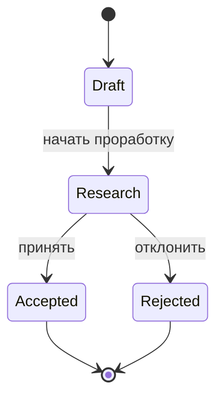
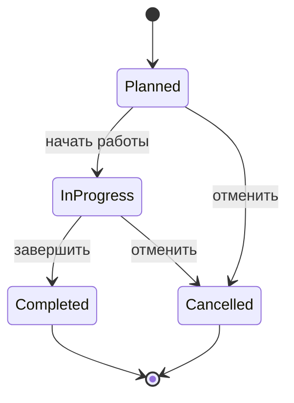

# OnlyPlans — Сквозные сценарии и жизненные циклы
> Версия 2.0. Неутверждённые переходы на диаграммах показаны как проектные предложения, а не окончательные правила.

## SC-01. Идея отклонена без разработки
1. Продакт создаёт Idea и описывает проблему и гипотезу.
2. Команда проводит Discovery и фиксирует результат.
3. Принимает решение отказаться от идеи и сохраняет причину.
4. Epic не создаётся. Idea остаётся доступной для просмотра и истории.

## SC-02. Одна идея → несколько эпиков
1. Продакт принимает Idea к реализации.
2. Редактор создаёт Epic A и Epic B со ссылкой на Idea.
3. Для Epic A применяет шаблон «Разработка»: системный анализ (5 рабочих дней), дизайн (5 рабочих дней), разработка.
4. Для Epic B создаёт этапы вручную.
5. В «Системном анализе» создаёт Task «Спроектировать API-метод» и «Построить Sequence Diagram».
6. Назначает исполнителей; оба Epic отображаются под одной Idea.

## SC-03. Технический эпик без идеи
1. Редактор создаёт Epic «Рефакторинг авторизации» без Idea и без шаблона.
2. Добавляет этапы вручную и назначает им длительности.
3. Создаёт задачи внутри этапов.
4. Epic отображается в роадмапе отдельно от идей.

## SC-04. Перепланирование с предпросмотром
1. Планировщик сокращает этап «Системный анализ» с пяти до трёх рабочих дней.
2. Система предварительно пересчитывает положение следующих этапов и их задач; длительности следующих этапов сохраняет.
3. Отображает новые даты и предупреждения о конфликтах, ограничениях и FS-связях.
4. Планировщик подтверждает или отменяет изменение.
5. После подтверждения изменения сохраняются и попадают в историю.
**Граница MVP:** пропорциональное сокращение длительности вложенных задач не выполняется; конфликтный алгоритм — OQ-04.

## SC-05. FS-зависимость
1. Пользователь наводит курсор на полосу Task A и тянет маркер зависимости на Task B.
2. Система проверяет отсутствие самоссылки и циклов.
3. Если связь допустима, создаёт FS-зависимость.
4. При нарушении сроков показывает предупреждение; детали магнитного пересчёта — OQ-04/OQ-05.

## SC-06. Ограничение «Не начинать до»
1. Планировщик задаёт для Task две рекомендуемые даты начала с причинами.
2. Плановая дата Task раньше одной из них; система показывает предупреждение и позволяет сохранить.
3. Первый исполнитель начинает работу до ограничения.
4. Система показывает диалог с датами и причинами и действием «Всё равно начать».
5. После подтверждения работа начинается; смена статуса отражается в обычной истории изменений.
6. Отдельная история нарушений не ведётся в MVP.

## SC-07. Несколько исполнителей и пересечение
1. Редактор назначает Task двум людям.
2. В представлении каждого человека видна одна и та же Task.
3. У первого исполнителя Task пересекается с другой задачей по рабочим дням; показывается предупреждение.
4. У второго пересечения нет. Общий статус и процент задачи одинаковы для обоих.

## SC-08. Конкурентное редактирование
1. Два редактора открывают одну задачу.
2. Первый сохраняет новый срок.
3. Второй пытается сохранить устаревшую версию.
4. Система не допускает незаметной перезаписи и предлагает обновить данные.

## Предлагаемая диаграмма состояний Idea (переходы уточнить в OQ-01)

Принятие Idea допускает создание нескольких Epic, но не создаёт их автоматически. Точные статусы, возврат на исследование и повторное открытие пока не утверждены.

## Предлагаемая диаграмма состояний Epic (переходы уточнить в OQ-02)

Это предложение для обсуждения, а не согласованный автомат состояний.
