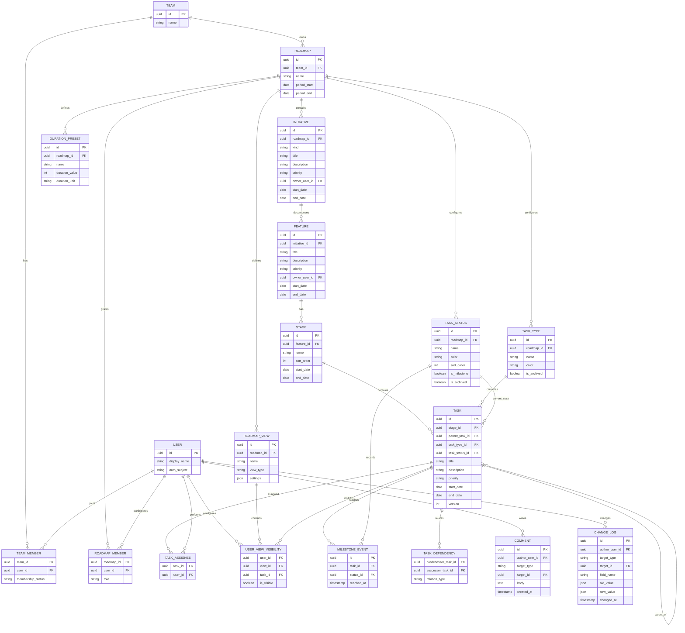

# OnlyPlans — ER-модель
> Логическая модель. Не физическая схема PostgreSQL. Кардинальности, отмеченные OQ, являются предположениями.

## Ограничения
- Все дочерние объекты принадлежат одному роадмапу по родительской цепочке.
- Тип/статус задачи и исполнитель принадлежат тому же роадмапу.
- Родитель и дочерние задачи в MVP — один этап.
- Зависимость не может связывать задачу с самой собой и не должна образовывать цикл.
- Уникальность видимости: user_id + view_id + task_id.
- Уникальность назначения: task_id + user_id.
- Версия задачи увеличивается при изменении общих полей; персональная видимость её не меняет.
- Комментарии и ChangeLog требуют контролируемой связи с целевым объектом; способ реализации FK определить при физическом проектировании.
- Визуальные части задачи по исполнителям — проекция Task + TaskAssignee, не отдельные задачи.

## Предположения
Initiative 1:N Feature (OQ-01). Даты — DATE, если не потребуется время суток. Веха фиксируется отдельным событием при переходе в статус с признаком is_milestone.
