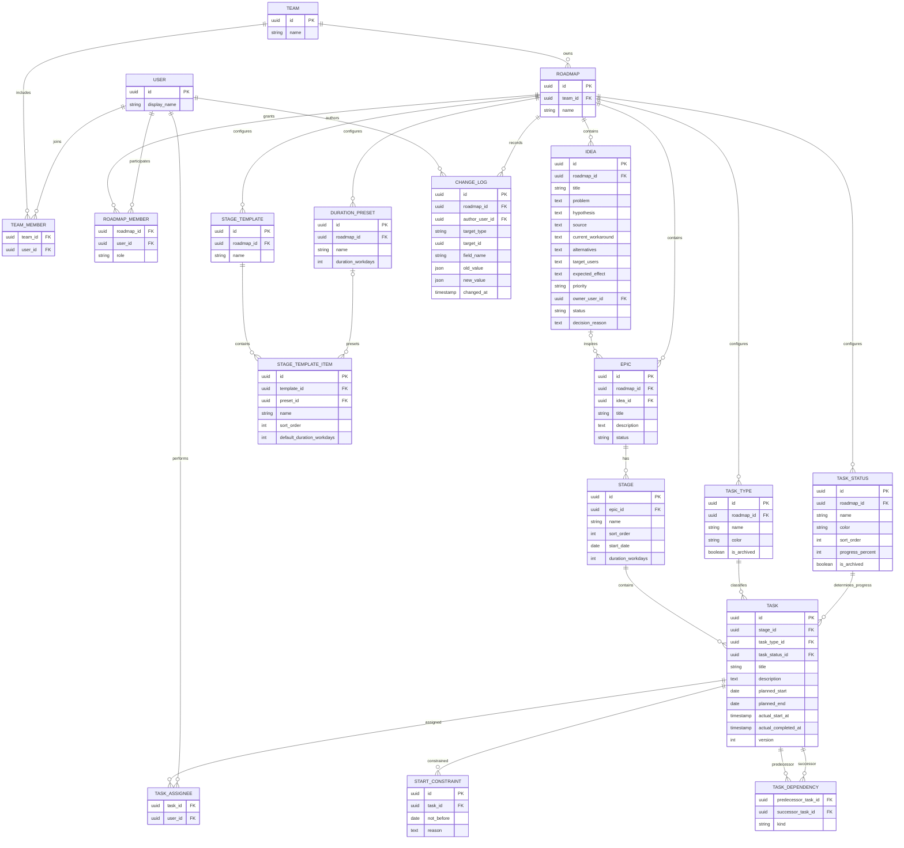

# OnlyPlans — ER-модель (концептуальная/логическая)
> Версия 2.0. Кардинальности согласованы для Idea/Epic/Stage/Task. Поля статусов и прав частично предварительные; это не физическая PostgreSQL-схема.

## Инварианты
1. `IDEA` — физическая сущность Discovery; отдельной таблицы `INITIATIVE` нет.
2. `EPIC.idea_id` допускает NULL. Одна Idea может быть связана с несколькими Epic.
3. `STAGE.epic_id` и `TASK.stage_id` обязательны; каждая Task принадлежит одному Stage.
4. Эпик может иметь ноль этапов; задачи без Stage запрещены.
5. Применение шаблона копирует элементы в Stage. Последующие изменения экземпляра не обновляют STAGE_TEMPLATE_ITEM.
6. Длительность Stage и пресетов — рабочие дни пн–пт; плановый конец вычисляется по старту и длительности. Точные правила границ — OQ-13.
7. Task может иметь нескольких исполнителей; прогресс общий, вычисляется из TASK_STATUS. Схема `progress_percent` в справочнике — **предложение** для решения OQ-03.
8. START_CONSTRAINT: ноль или много записей на Task; изменение даты предлагает обновить причину.
9. TASK_DEPENDENCY.kind = FS; запрет самоссылок и циклов требует проверки на уровне приложения/БД.
10. История изменения ограничения — CHANGE_LOG; отдельной таблицы событий нарушения в MVP нет.
11. Все связи между Epic/Stage/Task/справочниками/исполнителями должны оставаться внутри одного роадмапа.
12. Фактические даты завершённых задач нельзя автоматически переписывать магнитом.

## За рамками этой диаграммы
Точная модель прав, комментарии, пользовательские настройки представлений, правила архивирования и жизненные циклы требуют решения OQ. Они не должны считаться удалёнными функциями только потому, что не детализированы здесь. Физические FK для полиморфного CHANGE_LOG определить отдельно.
